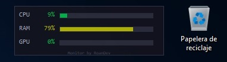

# 🖥️ Monitor CPU/RAM/GPU

Overlay transparente para Windows que muestra uso de **CPU**, **RAM**, **GPU**, **VRAM** y **red** en tiempo real. Sin bloat, sin dependencias externas, solo lo esencial.



---

## 🎯 Características

- **1 solo archivo** — lógica completa en `monitor.c`
- **<170 KB el EXE** — compilado con optimización de tamaño (MSVC ~169 KB / MinGW ~51 KB)
- **Solo APIs nativas** — Win32 GDI + PDH + DXGI, cero librerías de terceros
- **Interfaz minimalista y compacta** — barras con texto y porcentaje dentro de cada barra
- **Overlay transparente** — siempre visible, nunca molesta
- **Recuerda posición, opacidad y escala** — se guarda automáticamente en el registro
- **Menú de configuración** — clic en el engranaje superior derecho

Lo que realmente importa: **cuánto están usando tu CPU, RAM, GPU y red ahora mismo**. Sin distracciones.

---

## ⚙️ Compilar

### MinGW-w64 (~52 KB)
```bat
build_mingw.bat
```

### MSVC (requiere Visual Studio Build Tools, ~169 KB)
```bat
build_msvc.bat
```

📦 **Salida**: `monitor.exe` — siempre bajo 300 KB

---

## ▶️ Ejecutar

```bat
monitor.exe
```

---

## 🎮 Controles

| Acción | Tecla/Acción |
|--------|--------------|
| Mover ventana | Click izquierdo + arrastrar |
| Menú contextual | Click derecho |
| Fijar posición | Menú → "Fijar posición" (o doble-click en bandeja) |
| Desfijar posición | Menú → "Desfijar posición" (o doble-click en bandeja) |
| Salir | Menú → "Salir" |

---

## 📋 Dependencias

- Windows 7+ (`_WIN32_WINNT 0x0601`)
- Solo APIs del sistema: `user32.lib gdi32.lib shell32.lib advapi32.lib pdh.lib`

---

## 🔧 Cómo funciona

| Componente | Método |
|------------|--------|
| **CPU** | PDH `\Processor Information(_Total)\% Processor Utility` |
| **RAM** | `GlobalMemoryStatusEx` — uso de memoria física |
| **GPU** | PDH `\GPU Engine(*)\Running Time` — contadores nativos de Windows |
| **VRAM** | PDH `\GPU Adapter Memory(*)\Dedicated Usage` + DXGI adapter memory |
| **Red** | `GetIfTable` — contadores de interfaces de red |
| **Posición/Opacidad/Escala** | Registry `HKCU\Software\RoanDev\MonitorOverlay` — se guarda automáticamente |

---

## 📝 Notas

- MinGW requiere flag `-municode` para `wWinMain`
- MSVC requiere `/utf-8` para strings Unicode con caracteres acentuados
- Icono y detalles de archivo embebidos en el EXE vía `icon.rc`
- Actualización cada 1 segundo vía timer
- GPU reenumera engines cada 5s para detectar nuevos procesos
- Mutex `MonitorCPU_RAM_GPU_SingleInstance` previene múltiples instancias
- Interfaz compacta tipo primera versión, con escalado 50%-150%

---

## 📸 Screenshot


---

<div align="center">

**Monitor by RoanDev**


</div>
